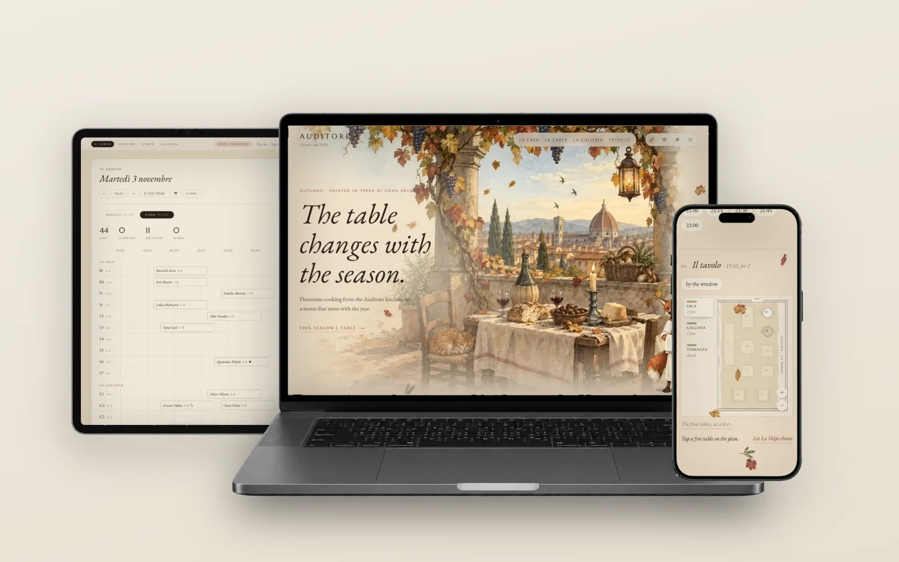
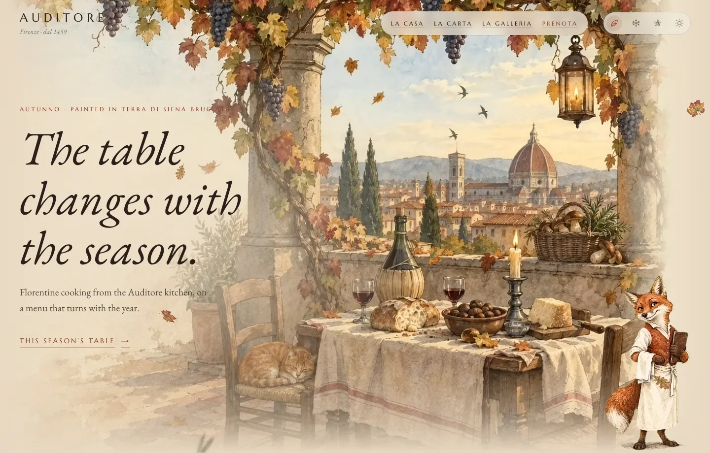
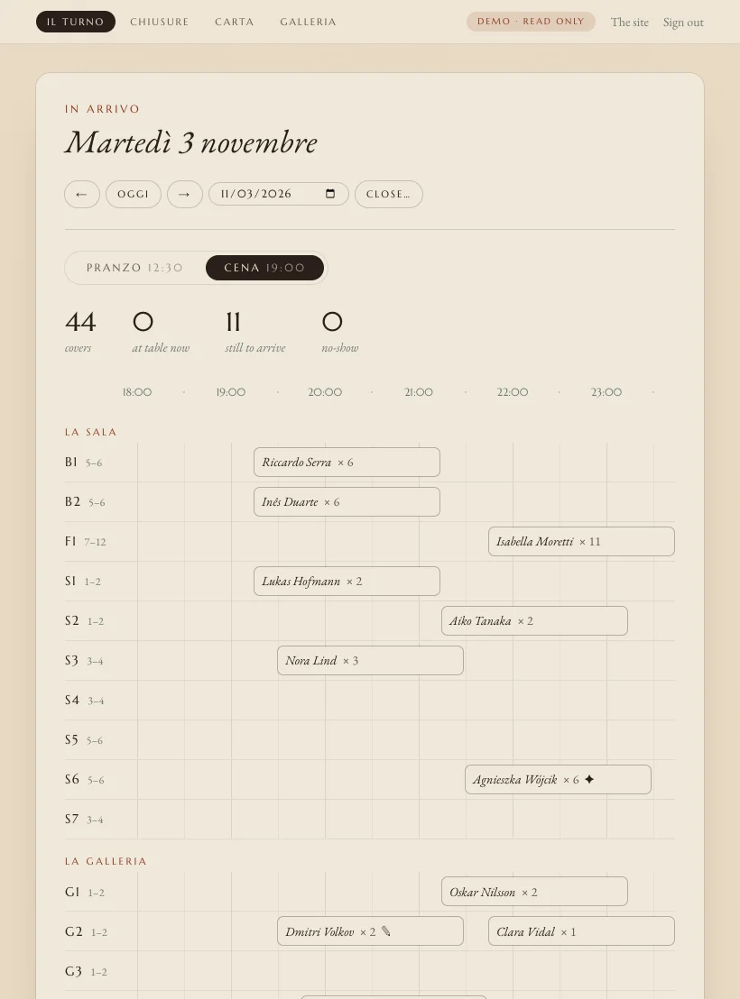
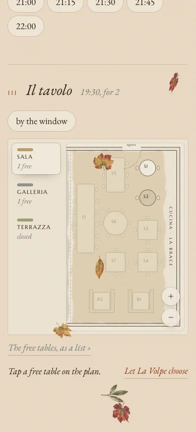

# Auditore · Trattoria Fiorentina

A website for a fictional Florentine trattoria, painted like a page from a Renaissance sketchbook. The whole site turns with the seasons: palette, living hero scene, falling leaves, snow or petals, and a seasonal menu. Guests pick their own table on a floor plan and get an instant confirmation.

**Live:** https://auditore-seven.vercel.app · **Back office:** [/admin](https://auditore-seven.vercel.app/admin), "Look around as a guest" opens a read-only demo.



## What it does

- **The seasons.** Four watercolour paintings with living loops, a palette and falling leaves, snow, petals or seeds for each; the menu's specials follow the calendar.
- **Booking on a floor plan.** Guests choose the hour and then the table itself, room by room; only tables that fit the party are offered, and the free tables can also be read as a list. Change or cancel from the link in the confirmation.
- **La Volpe, the head waiter.** A fox at the corner of the page answers questions about the menu and hours and offers a free table to book (Claude Haiku with tools over the same booking engine).
- **The back office.** A timeline of the day's tables (seat, finish, move, walk-ins), closures of the house or one room, the menu and the day's chalkboard, and the gallery, all behind Better Auth.

| Home | Il Turno, the day's tables | Booking on a phone |
|---|---|---|
|  |  |  |


## Stack

- Next.js 16 (App Router, Cache Components), React 19, TypeScript, Tailwind CSS v4
- Neon Postgres + Drizzle ORM; double bookings are rejected by a Postgres exclusion constraint
- Better Auth (owner and read-only demo accounts), Vercel Blob for the gallery, Vercel Cron for the demo's daily bookings
- La Volpe: Claude Haiku via the Anthropic SDK tool runner
- Illustrations: OpenAI GPT Image 2.5; living hero loops: Seedance 2.0 on fal.ai
- Deployed on Vercel

## Development

```bash
bun install
vercel env pull          # database credentials into .env.local
bun run db:migrate
bun run db:seed
bun run dev
```

Hand-managed keys (`OPENAI_API_KEY`, `FAL_KEY`, `ANTHROPIC_API_KEY`) live in `.env`, which `vercel env pull` never touches.

## Art pipeline

| Step | Command |
|---|---|
| Draw (prompts in `art/prompts.ts`) | `bun scripts/generate-image.ts hero/autumn` |
| Pad a hero to 16:9 for video | `python3 -I scripts/pad-hero.py autumn` |
| Animate (clips in `art/motion.ts`) | `bun scripts/animate.ts hero/autumn` |
| Encode loop + poster for the web | `bun scripts/encode-video.ts <in.mp4> public/hero/autumn art/approved/hero-autumn-16x9.png` |

Raw generations land in `art/drafts` (ignored); approved stills live in `art/approved`.

## Tests

```bash
bun test        # booking engine, admin actions, clock and prices against an in-memory Postgres (PGlite)
bun run e2e     # Playwright, desktop and phone; read-only, so E2E_URL can point at production
```

CI runs typecheck, lint and `bun test` on every push, and walks the live site in a browser every morning.
